 

<h3 align="center">🔮 ABOUT</h3>

- 🎓 CS undergraduate, enrolled in the **DecodeLabs Data Science Industrial Training Kit (Batch 2026)**
- 📈 Building end-to-end **EDA, ML, and analytics** projects on real-world datasets
- 🤖 Learning Linear Regression, Ridge, Random Forest with scikit-learn
- 📊 Exploring **Power BI** and **Data Engineering fundamentals**
- 📦 Published open-source Python libraries on PyPI (**350+ downloads**)
- 📍 Lahore, Pakistan · 🎯 Targeting DS / ML internships
- ⚡ Fun fact: I debug SQL by staring at it very intensely until it works

### 🧠 SKILL PROGRESS

| Focus | Level |
|:--|:--|
| 🐍 Python & Data Analysis |  |
| 🤖 Machine Learning |  |
| 🗄️ SQL & Databases |  |
| 📊 Power BI |  |
| ⚙️ Data Engineering |  |

<h3 align="center">⚙️ TECH STACK</h3>

  

<h3 align="center">🚀 FEATURED PROJECTS</h3>

<table>
<tr>
<td width="50%" valign="top">

### 💳 Credit Card Fraud Detection
Logistic Regression & Random Forest with SMOTE, GridSearchCV tuning, ROC-AUC evaluation.

 

</td>
<td width="50%" valign="top">

### 🏦 Loan Prediction: EDA & Features
Missingness audit, IQR outlier capping, one-hot encoding, multicollinearity removal. 573 clean rows, 23 features.

 

</td>
</tr>
<tr>
<td width="50%" valign="top">

### 🛒 E-Commerce Data Pipeline
PostgreSQL raw→staging→analytics, star schema, window functions, tests, CI/CD with GitHub Actions.

 

</td>
<td width="50%" valign="top">

### 📦 smilo: Open Source Library
Published on PyPI, 350+ downloads. [View on PyPI →](https://pypi.org/project/smilo/)

</td>
</tr>
<tr>
<td width="50%" valign="top">

### 🛍️ UK Retail: RFM Segmentation
EDA and RFM segmentation on 530K+ retail transactions.

</td>
<td width="50%" valign="top">

### 📺 Pakistani YouTube Creator Analysis
Channel performance analysis with the YouTube Data API v3.

</td>
</tr>
</table>

**[🔗 Explore all projects →](https://dsfahad.github.io/portfolio.fahad/)**

<h3 align="center">📊 GITHUB STATS</h3>

<h3 align="center">📈 CONTRIBUTION ORBIT</h3>

  

<!-- Themed contribution grid + snake (needs .github/workflows/snake.yml) -->

